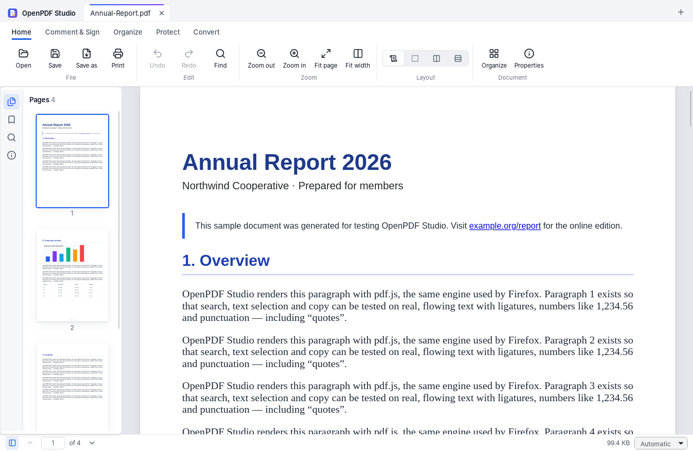
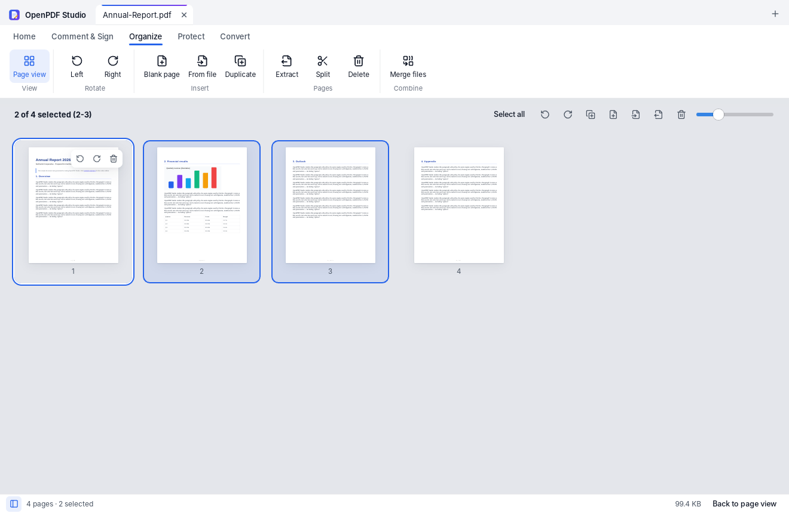
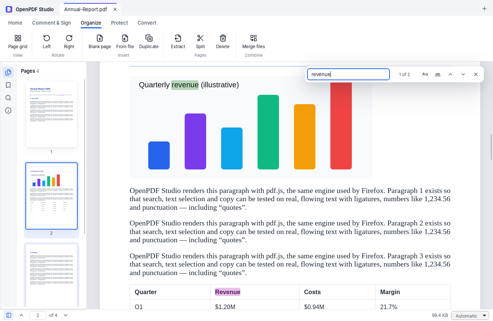
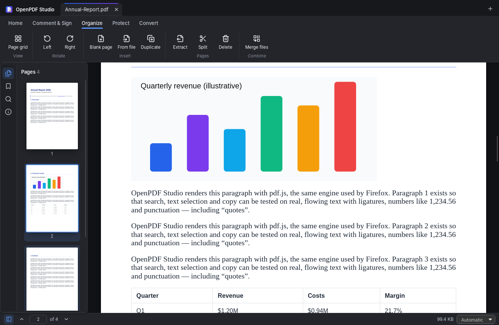

# OpenPDF Studio

**A free, open-source, offline PDF editor for Windows, macOS and Linux.**
No accounts, no subscriptions, no ads, no watermarks, no telemetry, no uploads.



| Organize pages | Search | Dark theme |
|---|---|---|
|  |  |  |

> **Status: 0.1 (first milestone).** Everything listed as available below is
> implemented end to end and covered by tests. Features that are *not* there
> yet are listed honestly under [Not yet available](#not-yet-available) with
> their implementation plan in [docs/ROADMAP.md](docs/ROADMAP.md).

## Available today

| Area | What works |
|---|---|
| **View** | Fast rendering (pdf.js), continuous / single page / two-page / wrapped layouts, zoom presets and Ctrl/⌘+wheel, page thumbnails, bookmarks, text selection and copy, find in document (match case, whole words), search across all open documents, internal links, external links only after confirmation, printing |
| **Comment & sign** | Highlight text, text boxes, freehand drawing, images, visual signatures (draw, type or upload — optionally remembered on this device); move, resize, restyle and delete them; fill interactive (AcroForm) forms |
| **Organize** | Rotate, delete, reorder (drag and drop or keyboard), duplicate, insert blank pages, insert pages from another PDF, extract pages (to a file or a new tab), split (every N pages, each page, custom ranges), merge files (page ranges per file, one bookmark per file, form fields kept) |
| **Convert** | Images → PDF (PNG, JPEG, GIF, BMP, TIFF, WebP; JPEGs embedded without recompression; EXIF orientation; transparency), PDF pages → PNG/JPEG at 72–600 dpi |
| **Protect** | AES-256 password protection with permission restrictions; remove protection (owner password); restricted documents are enforced in the UI; editing keeps a document's existing protection (AES-256, AES-128, RC4) |
| **Document** | Properties (title, author, subject, keywords, application; XMP kept in sync), file-size optimisation (lossless clean-up or image downsampling), document information and security summary |
| **Safety** | Undo/redo (60 steps) for every change, crash recovery of unsaved work, atomic saves, warning when the file changed on disk, warning before edits that would invalidate digital signatures, damaged files open view-only |
| **Workflow** | Tabs, recent files, drag and drop, “Open with” / file association, single instance, light / dark / system theme, keyboard shortcuts (Ctrl/⌘+/ lists them), command line tool with parallel batch processing |

## Not yet available

These are real gaps, not hidden buttons — the app does not show controls for
them. Each has a concrete design in [docs/ROADMAP.md](docs/ROADMAP.md).

* **Editing existing text** of a PDF (planned on PDFium's page-object API, compiled to WebAssembly).
* **Permanent redaction** (planned on PDFium's content-removal redaction API with automated verification that redacted text is gone).
* **OCR** for scanned documents (planned with Tesseract / `ocrs`, fully local).
* **Cryptographic digital signatures** (certificate-based, PAdES) and signature validation.
* **Creating form fields**, document comparison, watermarks / headers / footers, editing bookmarks.
* **Office conversions** (Word, Excel, PowerPoint) — only once fidelity can be demonstrated.
* Printing is rasterised at 150 dpi (vector printing planned); very large files are loaded fully into memory (range loading planned).

## Install

Pre-built installers are produced by CI for every push (`openpdf-studio-<OS>`
artifacts of the **OpenPDF Studio** workflow) and attached to draft releases
for tags `openpdf-v*`. Builds are unsigned unless signing secrets are
configured, so Windows SmartScreen and macOS Gatekeeper will warn — verify the
published SHA-256 checksums.

### Build from source

Requirements: [Rust](https://rustup.rs) (stable), [Node.js 22](https://nodejs.org), and the
[Tauri prerequisites](https://tauri.app/start/prerequisites/) for your OS
(WebView2 + MSVC build tools on Windows, Xcode command line tools on macOS,
`libwebkit2gtk-4.1-dev libgtk-3-dev librsvg2-dev` on Linux).

```bash
cd openpdf-studio/app
npm ci
npx tauri dev          # run in development mode
npx tauri build        # installers in ../target/release/bundle/
```

## Command line

The same engine is available as `opdf`:

```bash
cargo run -p opdf-cli -- info report.pdf
opdf merge a.pdf b.pdf c.pdf -o all.pdf --bookmarks
opdf split big.pdf --every 10 --out-dir parts/
opdf split big.pdf --ranges 1-3 4- --out-dir parts/
opdf extract report.pdf --pages "1-3, 7" -o summary.pdf
opdf rotate scan.pdf --pages even --degrees 180 -o fixed.pdf
opdf delete report.pdf --pages last -o trimmed.pdf
opdf images2pdf *.jpg -o photos.pdf --page-size a4 --margin 24
opdf protect *.pdf --out-dir protected/ --user-password secret     # parallel batch
opdf protect form.pdf -o locked.pdf --owner-password boss --no-modify --no-assemble
opdf unprotect locked.pdf --password boss -o open.pdf
opdf optimize scans/*.pdf --out-dir small/ --max-dpi 150 --quality 75
opdf meta report.pdf --title "Annual Report" --author "Ada" -o out.pdf
```

Passwords can also be passed with the `OPDF_PASSWORD` environment variable.

## Privacy

OpenPDF Studio makes no network connections of its own: no telemetry, no
update pings, no fonts or scripts from the internet (all pdf.js assets are
bundled). Links inside documents open in your browser only after you confirm.
Settings and recent files are stored locally in SQLite; unsaved-work recovery
copies are kept in a private application folder (password-protected documents
stay encrypted there) and are removed on normal exit. Passwords are never
written to disk.

## How it is built

* **Rust engine (`crates/opdf-core`)** on [lopdf](https://github.com/J-F-Liu/lopdf): page
  operations, merge/split, images to PDF, metadata, encryption, optimisation, and a
  versioned document session with undo/redo, saving and crash recovery.
* **Desktop shell (`app/src-tauri`)** with [Tauri 2](https://tauri.app): a narrow,
  grant-checked command API — the web UI never names file paths.
* **UI (`app/src`)** in React + strict TypeScript on [pdf.js](https://mozilla.github.io/pdf.js/)
  for rendering, text, search, forms and annotation editing.
* **CLI (`crates/opdf-cli`)** over the same engine.

Details, library evaluation and licensing: [docs/ARCHITECTURE.md](docs/ARCHITECTURE.md).

## Development

```bash
cargo test                                   # engine + CLI (uses qpdf for validation when installed)
cargo clippy --workspace --all-targets -- -D warnings
cd app && npm test && npm run typecheck      # UI unit tests
# End-to-end tests drive the real app (Linux: WebKitWebDriver + tauri-driver):
npx tauri build --debug --no-bundle && xvfb-run node e2e/run.mjs
```

See [CONTRIBUTING.md](CONTRIBUTING.md) and [SECURITY.md](SECURITY.md).

## License

[Mozilla Public License 2.0](LICENSE) — free for personal and commercial use.
Modified source files must stay open; you can combine the code with other
software under different licenses. Third-party components and their licenses
are listed in [THIRD_PARTY_NOTICES.md](THIRD_PARTY_NOTICES.md).
